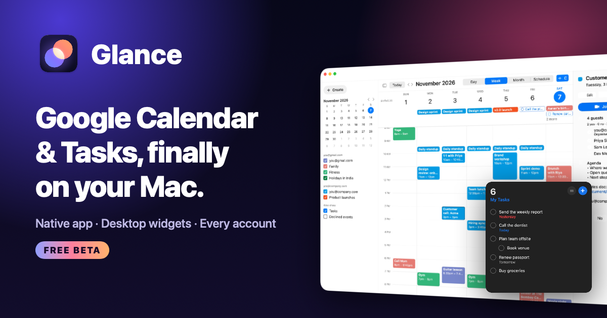
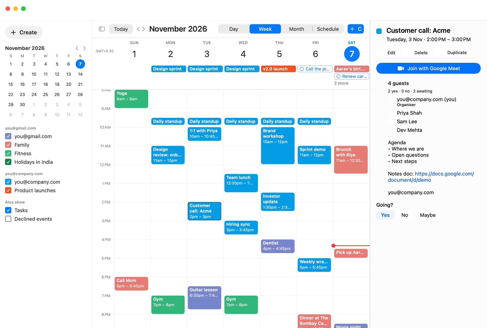
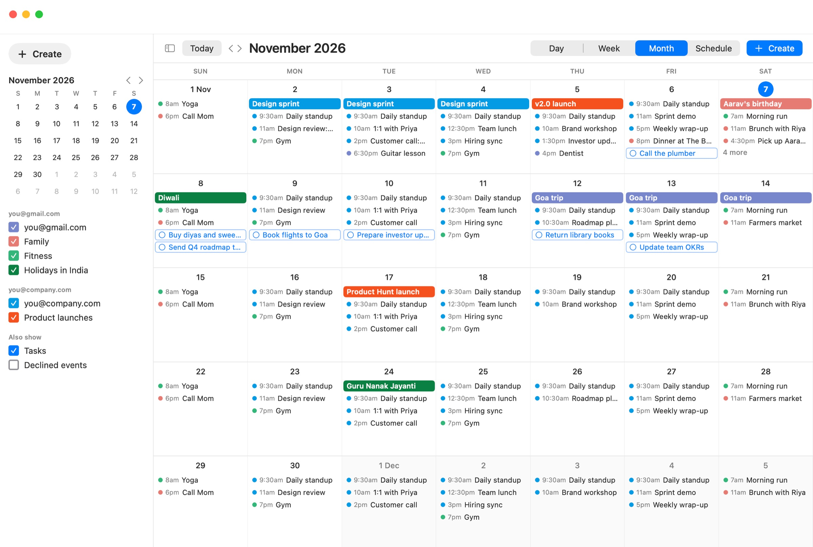
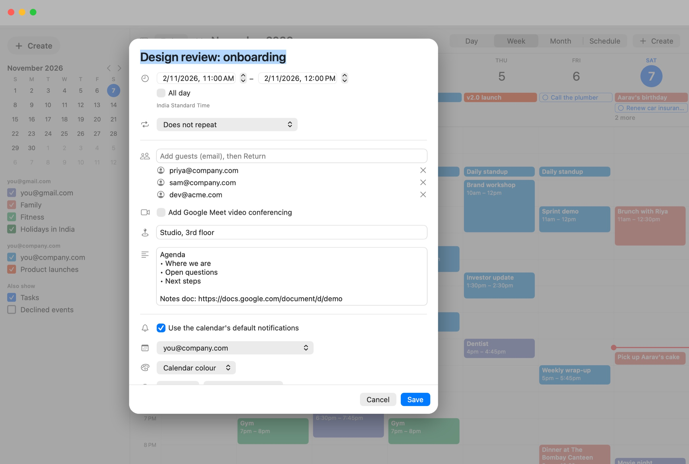
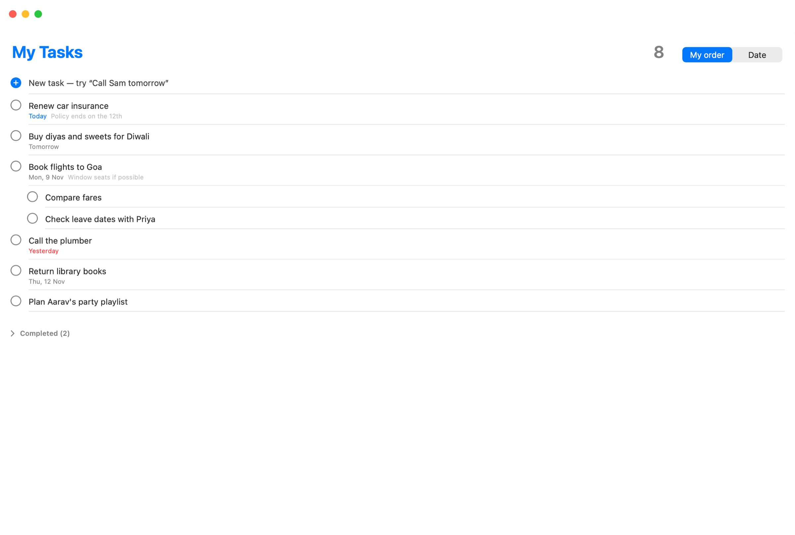
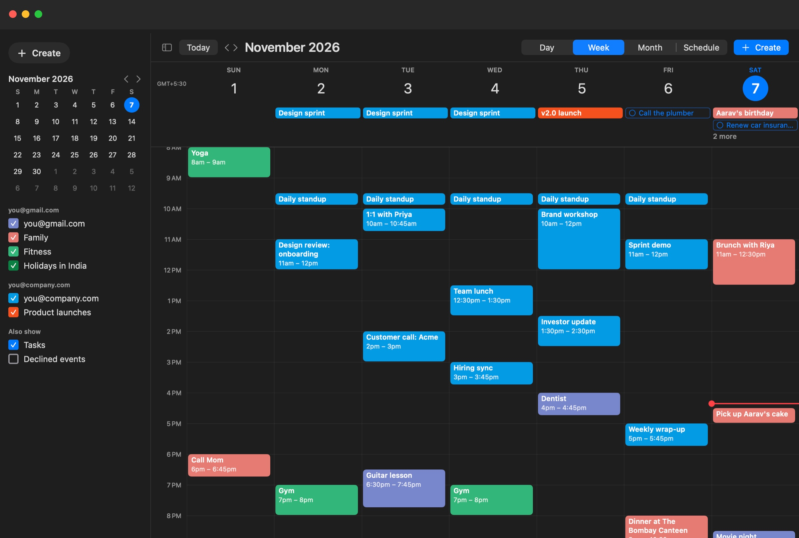
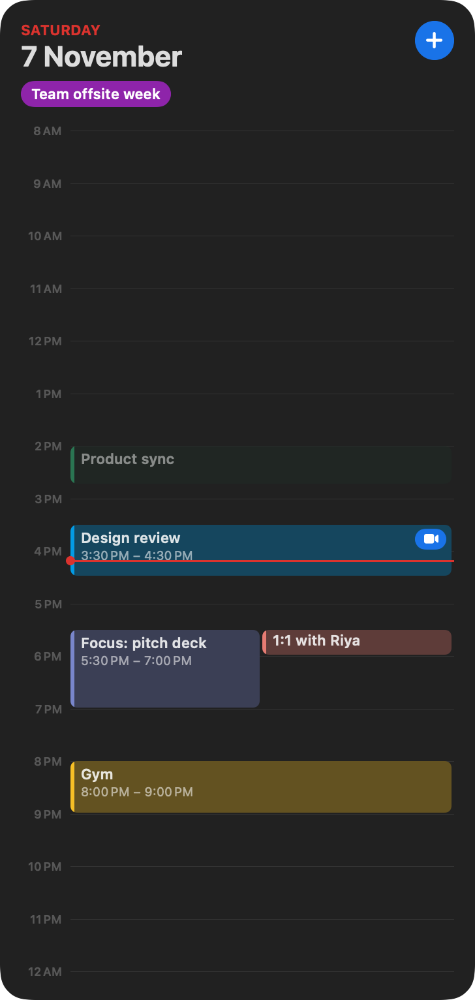
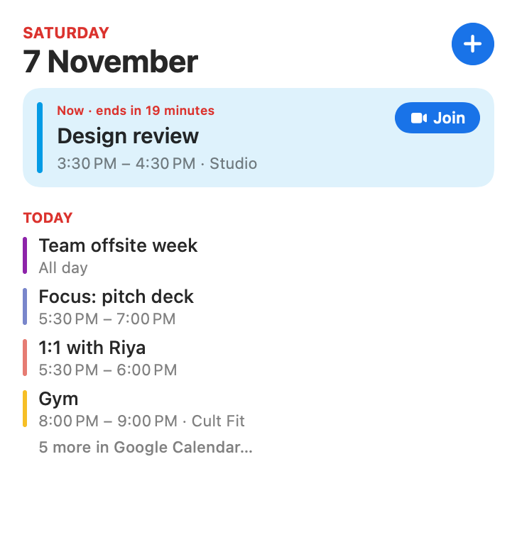
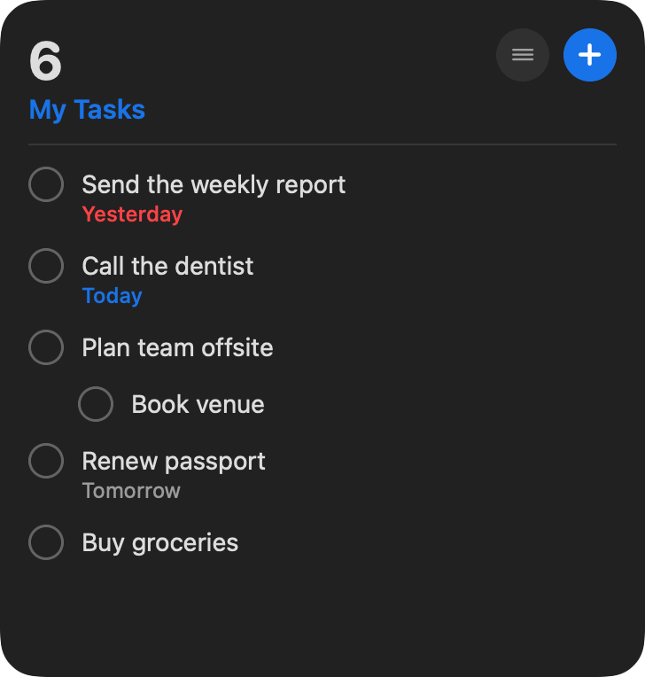

<p align="center">
  <a href="https://kaizarraja.github.io/glance/"></a>
</p>

<p align="center">
  <a href="https://kaizarraja.github.io/glance/"><b>Website</b></a> ·
  <a href="https://github.com/kaizarraja/glance/releases/latest/download/Glance.zip"><b>Download</b></a> ·
  <a href="https://github.com/kaizarraja/glance/issues"><b>Feedback</b></a> ·
  <a href="https://kaizarraja.github.io/glance/privacy.html">Privacy</a>
</p>

<p align="center">
  
  
  
  
</p>

---

**Glance** is the Google Calendar and Google Tasks app Google never made for macOS. A fast native window with Day, Week, Month and Schedule views, every Google account side by side, and real desktop widgets.

## Install

Paste this into **Terminal**:

```bash
curl -fsSL https://kaizarraja.github.io/glance/install.sh | bash
```

It downloads the latest release, puts **Glance** in Applications and opens it. Or [download the zip](https://github.com/kaizarraja/glance/releases/latest/download/Glance.zip) yourself (macOS will ask you to approve it once in **System Settings → Privacy & Security → Open Anyway**).

Then click **Sign in with Google**. While Google reviews the app, it shows "Google hasn't verified this app": click **Advanced → Go to Glance**.

## A tour



<table>
  <tr>
    <td width="50%"><p align="center"><b>Month</b>: events and dated tasks, drag between days</p></td>
    <td width="50%"><p align="center"><b>Editor</b>: repeats, guests, Meet, notifications, colours</p></td>
  </tr>
  <tr>
    <td><p align="center"><b>Tasks</b>: lists, subtasks, notes, drag to reorder</p></td>
    <td><p align="center"><b>Dark mode</b>, of course</p></td>
  </tr>
</table>

## Desktop widgets

<p align="center">
  
  
  
</p>

Agenda, Today timeline and Tasks widgets in every size, from small to the tall portrait one. Tick tasks off, page through lists and join meetings straight from the desktop.

## Features

| Calendar | Tasks | Everywhere |
|---|---|---|
| Day, Week, Month and Schedule views | All your lists, with counts | Every Google account in one view |
| Click or drag to create, drag to move or resize | Subtasks, notes and due dates | Widgets for Calendar and Tasks |
| Repeating events: this / following / all | Drag to reorder, move between lists | Quick Add from anywhere (<kbd>⌃⌥T</kbd>) |
| Join Google Meet, RSVP Yes / No / Maybe | Completed tasks, restore or clear | Optional hot corner |
| Guests, notifications, colours, visibility | Natural dates: "Call Sam tomorrow" | Google's keyboard shortcuts |
| Search across all calendars | Dated tasks on the calendar | Light and dark |

## Privacy

There's no Glance server. The app talks straight to Google from your Mac and keeps everything on your Mac: no analytics, no ads, no accounts. Read the [privacy policy](https://kaizarraja.github.io/glance/privacy.html).

## Feedback

Found a bug or have an idea? [Open an issue](https://github.com/kaizarraja/glance/issues). Screenshots help.

---

<sub>Made by <a href="https://github.com/kaizarraja">Kaizar Raja</a>. Glance is independent and isn't made, endorsed or sponsored by Google. Google Calendar, Google Tasks and Google Meet are trademarks of Google LLC.</sub>
